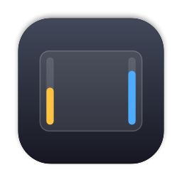
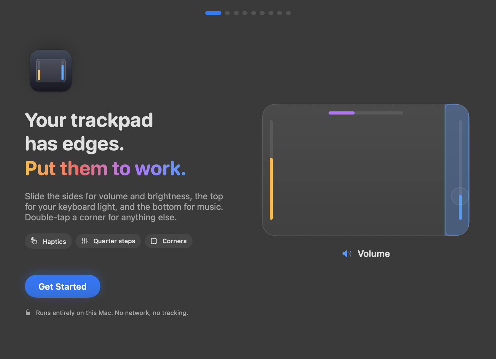
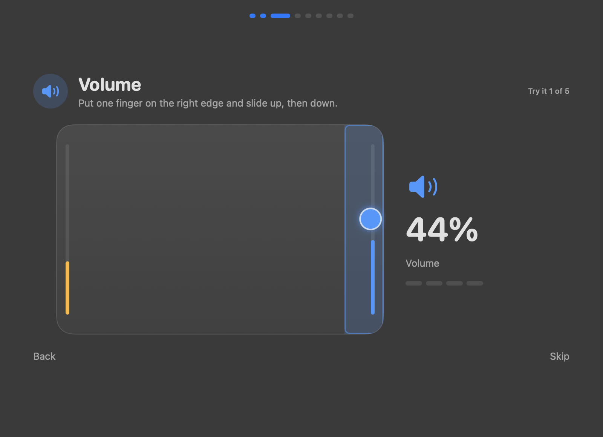
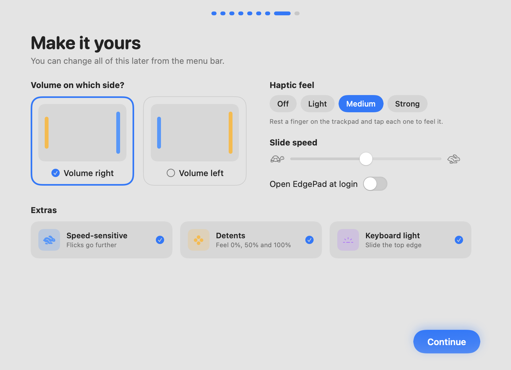
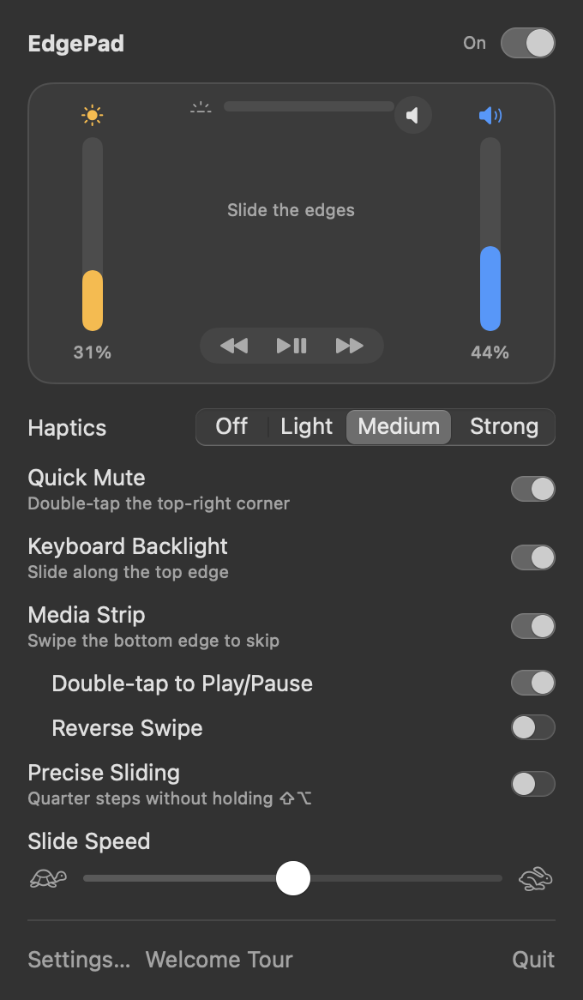

<p align="center">
  
</p>

<h1 align="center">EdgePad</h1>

<p align="center">
  <b>Your trackpad has edges. Put them to work.</b><br>
  Slide the sides of your MacBook trackpad for volume and brightness, the top for your keyboard light,<br>
  the bottom for music, and double-tap the corners for anything else. Free and open source.
</p>

<p align="center">
  
</p>

## What it does

| Gesture | Action |
| --- | --- |
| Slide the **right edge** | Volume, with the native macOS on-screen display |
| Slide the **left edge** | Display brightness |
| Slide along the **top edge** | Keyboard backlight |
| **Double-tap a corner** | Mute, Play/Pause, Mission Control, Show Desktop, Lock Screen, Screenshot, Spotlight, Sleep Display, or any Shortcut |
| **Swipe the bottom edge** | Next / previous track |
| **Double-tap the bottom edge** | Play / pause |
| Hold **⇧⌥** while sliding | Fine quarter steps |

**Feel**
- Haptic ticks under your finger (Off / Light / Medium / Strong), driven straight from the Force Touch actuator.
- Detents: a firmer bump at 0%, 50% and 100%.
- Speed-sensitive sliding: a quick flick covers more range, a slow slide stays exact.
- Precise Sliding: quarter steps without holding any keys.

**Stays out of your way**
- The pointer stays hidden and still while you slide.
- Clicks from tapping an active corner are held back, so a double-tap that mutes doesn't also double-click.
- Survives the trackpad briefly losing your finger, and picks the trackpad back up after sleep or a reconnect.
- Swap sides, bottom-quarter-only mode, required modifier key, edge width, slide speed.
- Light and Dark appearance, open at login, optional Magic Mouse support.
- Menu bar only. No Dock icon, ~0% CPU when idle. No network access.

**Haptic pings for scripts and AI agents.** Let a long build or an AI coding agent tap your trackpad when it finishes:

```bash
~/Applications/EdgePad.app/Contents/MacOS/EdgePad --buzz done   # tap | done | attention | error
```

<p align="center">
  
  
</p>

<p align="center">
  
</p>

## Install

Requires macOS 13 Ventura or later, a Force Touch trackpad, and Xcode or the Xcode command line tools.

```bash
git clone https://github.com/Bot-Rakshit/Edge-Bar.git
cd Edge-Bar
./build.sh
```

`build.sh` compiles a release build, bundles `EdgePad.app`, signs it (with your Apple Development identity if you have one, ad-hoc otherwise), installs it to `~/Applications` and launches it. The welcome tour walks you through granting Accessibility access and trying every gesture.

> If you build with ad-hoc signing, macOS treats each rebuild as a new app, so you'll need to turn Accessibility back on after rebuilding.

## How it works

- **Touches** come from Apple's private `MultitouchSupport` framework, which reports every finger's position on the trackpad about 100 times a second.
- **Gestures** are recognized by a small, pure state machine in [`GestureEngine.swift`](Sources/EdgePad/GestureEngine.swift), covered by 46 self-tests:
  ```bash
  swift build -c release && .build/release/EdgePad --selftest
  ```
- **Volume and brightness** are sent as the same system key events the keyboard's media keys produce, so you get the real macOS on-screen display. Quarter steps use macOS's own ⇧⌥ behaviour.
- **Keyboard backlight** goes through `CoreBrightness`, **haptics** through the `MTActuator` API.

`EdgePad --diagnose` prints what it finds on your Mac (trackpad, haptics, volume, brightness, keyboard light). Gesture events are logged to `~/Library/Logs/EdgePad.log`; turn on detailed logging with `defaults write com.rakshit.edgepad verboseLog -bool YES`.

Private frameworks can change between macOS releases. If something stops working after an update, please open an issue.

## Credit

Inspired by [EdgeBar](https://edgebar.xyz) by Shashank Bhardwaj, a polished paid app built around the same idea. EdgePad is an independent project and is not affiliated with it. If you want a supported app, go buy EdgeBar.

## License

[MIT](LICENSE). Free to use, modify and share.
